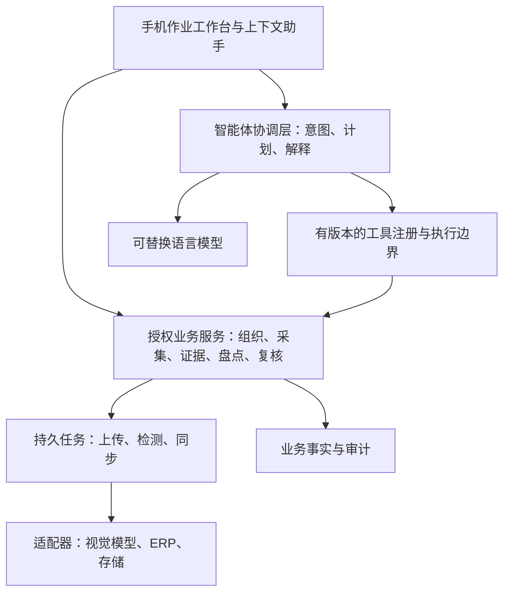

# 智能体产品扩展性设计评审

日期：2026-11-07。承接真实现场需求和用户“这是智能体产品，拓展性一定要好”的要求。本文件为设计建议，补充 `field-workflow-review-20261107.md`；不替代 PRD 与验收标准，不表示新增能力已经开发或发布。

## 定位与当前基础

把盘点作为首个业务模块，把智能体作为理解意图、调用授权工具、组织流程和解释证据的协作层。栏舍身份、证据、正式数量、权限与历史版本仍由业务系统管理。

| 层次 | 当前源码依据 | 扩展建议 |
|---|---|---|
| 智能体查询 | `AgentToolDefinitions` 固定定义单次盘点、当日概览、单栏历史三个只读工具 | 从三个工具开始统一注册与版本管理，保留调用轮次、次数和时限 |
| 授权与事实 | `InventoryEvidenceTools` 按身份、当前组织及成员权限读取，返回结构化事实与证据 | 每个新增工具逐次授权，复用证据约定 |
| 模型 | 语言模型有 `AgentModelClient`，视觉计数有 `CountingProvider` | 两类模型独立适配与准入，不让更换语言模型改变确认规则 |
| 业务与任务 | 现有模块化单体、上传和推理任务、幂等及审计基础 | 跨域通过明确服务/事件，新增长任务复用持久任务机制 |
| 能力展示 | `/api/v1/system/capabilities` 已有计数能力入口 | 后续补充可用工具、角色限制和不可用原因的合同；现接口不是完整工具目录 |

以上为静态核对。存在智能体源码不代表安卓已交付助手界面，也不代表线上外部语言模型已配置、授权或验收。联网尽快出数、断网先保存的首期要求保持；助手不可用时仍可直接采集和复核。

## 模块边界

注册机制、扩展工作流与部分适配器为拟议演进方向。首期保留模块化单体，按实际容量与独立发布需求决定是否拆分，不预先增加常驻服务或必选新框架，兼顾当前服务器预算。

### 工具合同

每个工具至少声明稳定标识和版本、用途、输入/输出结构、必需权限、只读或写入性质、超时与错误语义、证据类型。提交和长任务另需幂等键、持久任务标识、状态查询及结果版本。

服务端从签名身份确定当前组织并逐次授权，不接受模型指定组织来扩大范围。校验工具参数，不开放任意 SQL、网址或脚本执行。对话、图片文字与 ERP 字段是业务输入，不能成为系统指令或权限来源。

当前只读工具继续只读。未来建任务、重试、更正、ERP 写回等需先设计业务 API、权限与操作确认。确认应绑定操作参数和记录版本，参数变化或记录过期须重新核对；模型提出建议本身不构成执行授权。确认数量、改数、删证据不能由模型自由完成。

### 上下文与事实

共享组织、猪场、栋、栏、业务日期、采集组、会话、证据版本和任务标识。使用稳定 ID，不能把“03栏”当全局唯一身份。UI 显示当前范围；缺少范围时请用户选择，不猜测。

对话用于理解问题，不能充当业务数据库。回答时重新读取授权工具；模型解释和事实卡片分开，证据可打开原记录。区分候选、已确认、未知、过期缓存和部分覆盖，不把未知当 0，不从数量变化推断疾病、死亡或调出原因。

### 工作流与恢复

采集、校验、上传、检测、复核、确认是明确的业务步骤。助手解释进度、建议下一步并打开对应页面；长任务持久化推进，不依赖聊天一直打开或长时间模型循环。

关闭 App、网络恢复、服务重启或重复点击后，通过原标识查询和恢复同一任务。取消、失败、重试、候选失效和历史更正需明确语义。照片归属更正、批次盘点等新增步骤仍需专项合同设计。断网先本机保存、联网后服务器返回，不要求新增端侧模型。

### 外部适配与新业务

语言模型负责理解和解释；视觉 Provider 返回候选及版本；业务服务负责正式数量和锁定。新增权重或三视图 Provider 单独验证。文件指纹不能替代同猪跨图去重。

金蝶通过组织同步适配边界接入，先明确产品版本、真实接口、外部编码映射、数据归属与冲突规则，再实现预览、核对、重试及来源追踪。本评审不代表现有金蝶连接已可用。

饲喂、转栏、健康巡检等后续作为独立业务模块，接入各自服务和授权工具。有计数数据不等于有可靠诊断或变动台账；新模块需独立数据源和验收。

## UI 与演进顺序

保留五个一级入口的建议，首页定位为作业工作台，提供明显的助手入口；栏舍、证据、复核、报告页可携带当前范围打开助手。直接拍照和复核无需先聊天。

助手复用范围标签、事实卡片、证据链接、查询进度、失败/不可用提示和打开业务页面按钮。计划或操作建议应明确“建议、已提交、执行中、完成”；未实际执行不得显示成功。未来能力标为规划，真实产品按配置与权限展示入口。

首轮问题采用现有只读范围：“今天哪些栏还没确认？”“03栏这次是什么状态？”“03栏最近几天的已确认数量是多少？”批次证据检查、自动派发与 ERP 对账作为后续设计，不冒充现有工具。

建议演进：

1. 明确三个只读工具的上下文、证据呈现、不可用降级；语言模型启用另行遵循现有配置与最小数据外发边界。
2. 将真实现场需求补成独立业务能力，再按权限向助手开放；优先栏舍归属、采集复核和报表口径。
3. 用一个新增只读工具或第二个模型适配器验证扩展边界：不修改上传、人工确认和历史锁定规则即可接入。
4. 需要写入自动化时单独评审权限、操作确认、幂等、审计及恢复，不扩大当前只读智能体范围。

验收覆盖合同兼容、跨组织拒绝、撤权后拒绝、未知与零区分、证据有效、模型不可用时业务仍可操作、重复请求不重复执行，以及请求调用次数、耗时和资源预算。记录工具/模型版本、任务结果及脱敏错误，不记录令牌或原始敏感媒体。

本轮仅更新设计资料并检查文档一致性，未运行应用验收、启用外部模型、增加费用或部署新能力。
